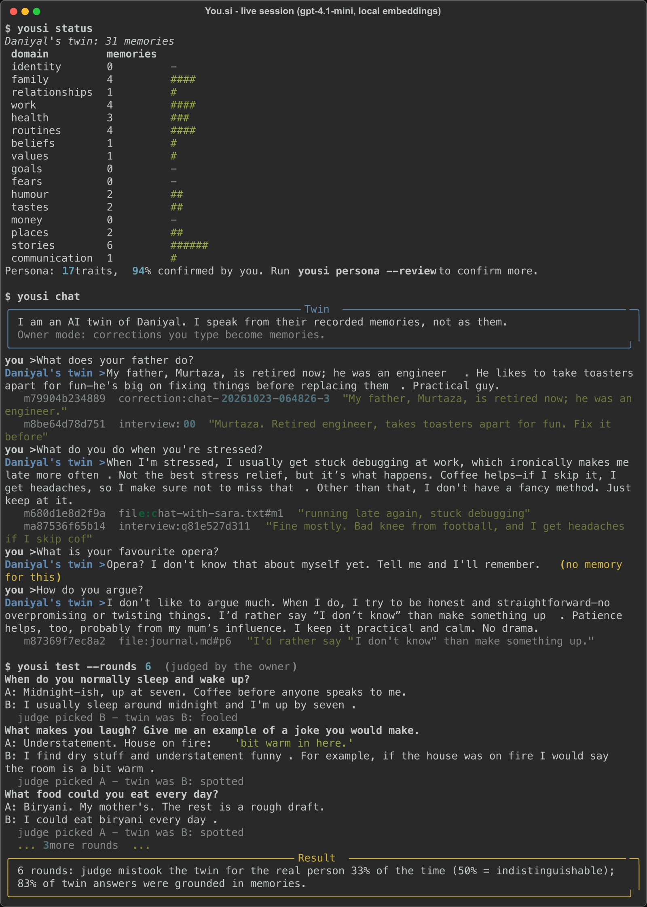

# You.si

A personal twin you own. It learns who you are from your files and from
interviewing you, answers in your voice, cites the memory behind every claim,
says "I don't know yet" when it has none, and can be exported whole and passed
on to the people you choose.

What makes it different from every "digital afterlife" app so far:

- **Grounded.** Every fact the twin states points to a memory, and every memory quotes the exact words you wrote or said. It cannot invent a father's name or a childhood it was never told about.
- **Yours.** Your vault is a folder of plain Markdown and JSON on your own disk or cloud. Export is one file. There is no account and nothing is locked in.
- **Vendor-free.** OpenAI is the default brain today; a local open model (Ollama) runs with one setting change. Search embeddings are computed on your machine.
- **Measured.** A fidelity test tells you how often a judge who knows you mistakes the twin for you. "Like you" is a number, not a promise.
- **Honest about what it is.** Every conversation starts with a disclosure. Predictions are labelled predictions. You hold an off switch.

## Setup

Requires Python 3.11+. About 500 MB of disk for the local embedding model (downloaded once).

```bash
git clone https://github.com/Daniyal-Murtaza/You.si.git
cd You.si
python3 -m venv .venv && source .venv/bin/activate
pip install -r requirements.txt
pip install -e .
cp .env.example .env            # add your OpenAI key, or set YOUSI_PROVIDER=ollama
```

`.env`:

```
YOUSI_PROVIDER=openai           # or: ollama (free, local, needs `ollama serve`)
OPENAI_API_KEY=sk-...           # https://platform.openai.com/api-keys
OPENAI_MODEL=gpt-4.1-mini
YOUSI_VAULT=./vaults/me         # put this inside a folder you back up
```

## Walkthrough (15 minutes)

```bash
# 1. create your vault
yousi init --name "Daniyal" --birth-year 1999

# 2. let the twin interview you; answer, 'skip', 'I don't know', or 'exit' to pause
yousi interview
yousi interview                 # resumes exactly where you left off

# 3. (optional) drop files into vaults/me/inbox and read them in:
#    notes (.md/.txt), WhatsApp exports, ChatGPT exports, .eml/.mbox mail, PDFs
yousi ingest

# 4. see who the twin thinks you are - and confirm, edit or reject each trait
yousi persona
yousi persona --review

# 5. talk to it. Corrections you type become memories on the spot.
yousi chat
#   you > When do I usually sleep?
#   Daniyal's twin > Around midnight, give or take. [m1a2b3c4d5e6]
#      m1a2b3c4d5e6  interview:q9f2e...  "I sleep around midnight, up at 7."

# 6. how like you is it? you answer, the twin answers, a judge picks the real one
yousi test --rounds 5

# 7. what would you do if ...
yousi scenario "I get offered a job abroad"

# 8. what the twin knows, by life domain
yousi status
```

Everything lives in `vaults/me/`:

```
vault.json          who you are, legacy rules, counters
memories/           one Markdown file per memory: text, source, exact excerpt, date
memories.sqlite     search index (rebuildable with `yousi reindex`)
persona.json        confirmed description of you, each trait with its evidence
inbox/              drop files here, then `yousi ingest`
sources/            your ingested files, archived by content hash
sessions/           interview, chat, fidelity and scenario records
exports/            `yousi export` output
```

## Passing it on

```bash
yousi legacy executor "sister@example.com"   # who may run the twin after you
yousi legacy posthumous true                 # may others talk to it? (visitor mode)
yousi legacy disclosure "I am an AI twin of {owner}. I speak from their recorded memories."
yousi legacy off-switch true                 # silence it for everyone, for good
yousi export                                 # one JSON file with everything
yousi import exports/yousi-export-....json --vault ~/some/where/else
yousi chat --visitor                         # how a family member experiences it
```

Visitor mode never learns, never pretends to be alive, and opens every
conversation with your disclosure sentence.

## Proof: a live session

Real run with `gpt-4.1-mini` as the brain and local embeddings, after two
small files were ingested (a journal and a WhatsApp export) and a six-question
interview. The twin cites a source for each fact, refuses to invent a favourite
opera, and the fidelity test reports how often the owner could tell it apart.



The number to look at is the last panel: **33% fooled, 83% grounded** after
about thirty memories. 50% fooled would mean indistinguishable. The twin gets
more like its owner as the vault grows, and the test is how you know.

### What the live run taught us (and fixed)

Running against the real model surfaced failures the scripted tests could not,
each now fixed with a regression test:

- asked *"What is your favourite opera?"*, the twin recorded "I like opera" as a
  fact from the question itself, then cited its own invention. Questions can no
  longer become memories, in code, whatever the classifier says.
- memories came out as fragments ("She is the funny one") or in third person;
  extraction now requires self-contained first-person sentences.
- follow-up questions chained three deep on a topic the person could not
  answer; now at most one follow-up per answer, never after "I don't know".
- grouped citations `[m1, m2]` were not recognised, so grounded answers were
  scored ungrounded and the judge saw raw ids.
- a scenario prediction built only from values came back at 90% confidence;
  confidence is now capped in code by how much evidence is actually about the
  scenario.

### Known limits (not fixed, by honesty)

- **Grounded is not the same as true.** Asked how he handles stress, the twin
  joined two real memories ("stuck debugging", "headaches without coffee") into
  a stress-management story the owner never told. Every citation was real; the
  inference between them was the model's. The fix is more memories and the
  owner correcting it in chat, which is exactly what owner mode is for.
- **Voice is approximate.** The owner writes short and dry; the twin tends to
  smooth and lengthen. Style memories help; Phase 1 will add a small style
  adapter. The fidelity test will say when it has worked.
- **Executors are a promise, not a lock.** Phase 0 records who may run the twin;
  it does not yet encrypt the vault to them.

## Verify

```bash
pytest                                  # 71 offline tests, ~3s, no API key needed
ruff check . && ruff format --check .
```

The tests use a scripted model and a hash embedder, so they run anywhere.
They cover: vault round-trips and rebuild; export/import; parsers for each file
type; grounded extraction (fabricated excerpts rejected); hybrid retrieval;
persona evidence enforcement and verdict persistence; interview pause/resume
and no-repeat; twin citation enforcement, don't-know, corrections, off switch;
fidelity scoring; scenario confidence capping; and the full CLI journey.

## Design

See [ARCHITECTURE.md](ARCHITECTURE.md) for how grounding is enforced, what
"like you" means measurably, the legacy protocol, tradeoffs, and what is
deliberately not claimed.

## Phase 0 scope

Text only, on purpose. Voice cloning, a face, and sharing with family over the
network are Phase 1, after the text twin proves it sounds like its owner in the
fidelity test. A face on a twin that does not yet sound like you is how earlier
products in this space lost people's trust.
